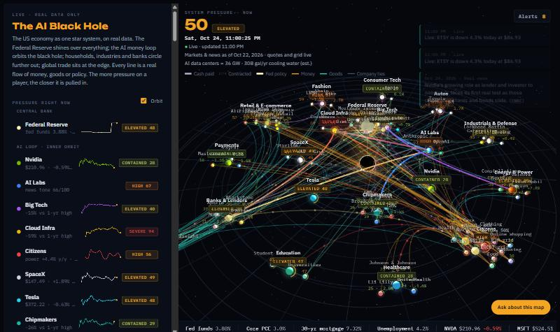

# The AI Black Hole

The US economy drawn as one star system, on real data.

The Federal Reserve is a fixed star above everything. The AI money loop (Nvidia, chipmakers, the
AI labs, Big Tech, cloud infrastructure, SpaceX/xAI, Tesla) orbits a black hole. Households,
banks, payments, retail, autos, fashion, education, healthcare, energy and industrials circle
further out, and global trade sits at the edge. Every line is a real flow of money, goods or
policy between them. The more pressure on a player, the closer it is pulled in.

Nothing is simulated or forecast. Every number comes from a public source, and the page shows
where.

**[Open the live demo →](https://klauscreates.github.io/ai-black-hole/)**



## Try it

- **Live site:** [klauscreates.github.io/ai-black-hole](https://klauscreates.github.io/ai-black-hole/),
  no install, works on phones. It updates itself (see [Hosting it live](#hosting-it-live)).
- **Offline:** open [`docs/index.html`](docs/index.html) in a browser. It is a single file with
  one day's data built in (marked "Saved copy"), and it works offline apart from the 3D engine,
  which loads from jsDelivr.
- **Live on your computer:** run the local server, which streams delayed stock quotes and
  5-minute power-grid data into the page.

  ```
  python live_server.py          # then open http://127.0.0.1:8787/
  python live_server.py --lan    # also reachable from your phone on the same Wi-Fi
  ```

  On Windows, `start_live.cmd` does the same and opens the browser. Standard-library Python 3 only;
  nothing to install.

## What you're looking at

| On the map | Meaning |
|---|---|
| Gold star above the center | The Federal Reserve. Its moons are the fed funds rate, core inflation, jobs, mortgage rates and the balance sheet. |
| Planets | 20 players: the AI loop on the inner orbit, the wider economy on the middle orbit, global trade outside. |
| Moons | 75 companies and concepts locked to their player: stocks, households by wealth, what they spend on, trading partners, tariffs. |
| Thick lines | Flows between players. Solid = cash paid, wireframe = contracted, gold = Fed policy. |
| Thin lines | Ties between companies and concepts. Amber = money, teal = goods. |
| Ring around a node | Its pressure score, 0–100. |

Hover anything for a card with its numbers, sources, pros, cons, weak point and news. Click a
player to focus it and see why its score is what it is.

**Pressure** starts from a baseline set by sourced facts about each player, then moves with live
signals: its stock price against its 1-year high, credit spreads, the Fed's rate, economic data
(sentiment, retail sales, prices, imports, delinquency), power prices and drought, and the tone of
recent news. **Fear & greed** blends stocks, credit, news and the economy into a mood score.

## How the data gets there

```
FRED, EIA, US Drought Monitor ──► market_snapshot.py ──┐
News search + analysis by Claude ──────────────────────┼──► snapshot JSON ──► the page
Yahoo quotes, ERCOT, CAISO, EIA hourly ──► live_server.py (live, local) ─────────┘
```

- `market_snapshot.py` builds the daily snapshot: credit spreads and Treasury yields, the Fed's
  rate, target range, balance sheet, core PCE and unemployment, mortgage rates, retail and
  consumer data, wealth shares, prices, imports, grid demand, power and gas prices, and drought
  at data-center counties.
- [`DAILY_REFRESH.md`](DAILY_REFRESH.md) is the prompt that has Claude search the news, write the
  per-player and per-flow analysis, and rebuild the snapshot each morning.
- `live_server.py` keeps the latest snapshot in memory, adds live quotes and grid data, and streams
  it to the page over server-sent events.
- `make_share.py` bakes a snapshot into a single HTML file (`--pages` also refreshes `docs/`).
- `sample/snapshot.json` is one real day of data (Oct 24, 2026) so everything works out of the box.

## Hosting it live

The public site keeps itself current with no server, using GitHub Actions
([`.github/workflows/live.yml`](.github/workflows/live.yml)) and `build_site.py`:

| When | What updates |
|---|---|
| Every 30 minutes, weekdays during US market hours | Stock quotes, ERCOT, CAISO and EIA hourly grid demand |
| Every morning (and the "Run workflow" button) | Everything above plus FRED, the Fed, daily grid demand, drought and economy data |
| Every push to `main` | Redeploys the code with the latest data |

Each run starts from the data the site is already serving, adds fresh data, and deploys the page
plus a `data.json` that open pages check every 5 minutes. Nothing is committed, so the history
stays clean. GitHub's scheduler is approximate, so runs can be a few minutes late, and GitHub
pauses schedules in repos with no activity for 60 days.

To run your own copy: in the repo's **Settings → Pages**, set the source to **GitHub Actions**;
in **Settings → Secrets and variables → Actions**, add a secret named `EIA_API_KEY` with a free
key from [eia.gov/opendata](https://www.eia.gov/opendata/) (without it, EIA's shared public key
is often rate-limited).

The news summaries and tone are the one part that doesn't update itself. Write a fresh
`data/analysis.json` with the [daily refresh prompt](DAILY_REFRESH.md) and push it; the next run
picks it up.

There is also an "Ask about this map" chat that sends the page's data to Claude. It only works
when the page runs as a published Claude artifact, where it uses the viewer's own Claude account.

## Sources and caveats

- **FRED** (Federal Reserve Bank of St. Louis): rates, Fed balance sheet, inflation, jobs, retail,
  trade and household series. The ICE BofA bond spreads are © ICE Data Indices, LLC and are shown
  under FRED's terms; their history is left out of the sample data.
- **EIA** grid and price data, the **US Drought Monitor**, and the **ERCOT** and **CAISO** public
  dashboards.
- **Stock quotes** come from Yahoo Finance's unofficial chart endpoint, delayed, for personal use.
  A hosted or commercial version should use a licensed market-data feed.
- **Company facts** link to their sources (SEC filings, company pages, news reports) in each card
  and in the page's source list.
- The AI data-center power and water footprint is an estimate scaled from Berkeley Lab figures,
  not a measurement.

**Not financial advice.** Pressure and fear & greed scores are a model built from public data, not
forecasts or recommendations.

## License

MIT. See [LICENSE](LICENSE).
